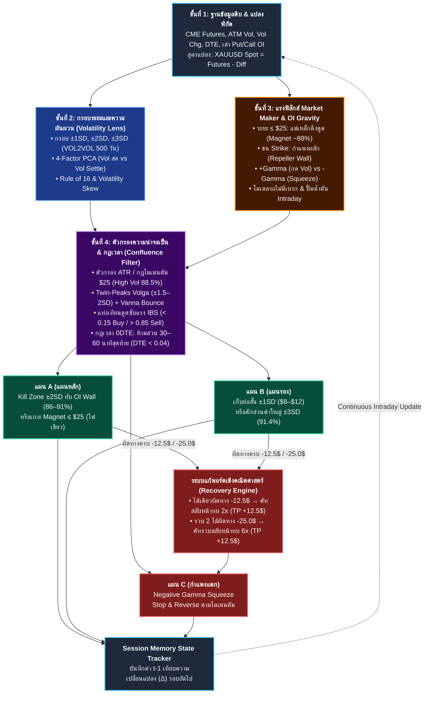
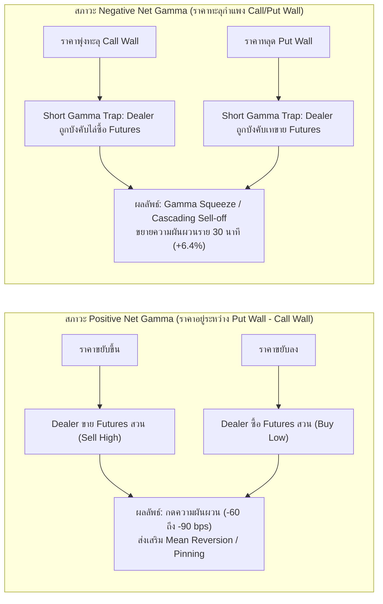
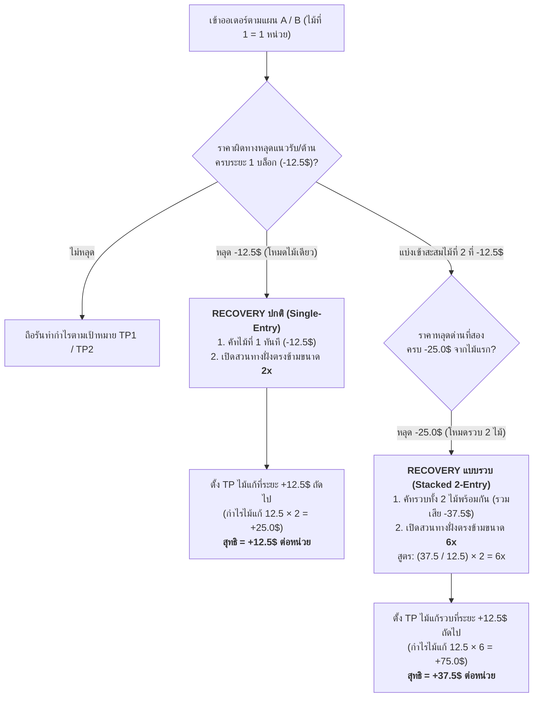

# Quantitative Gold Derivatives & CME Microstructure Framework

> **100% Pure Quantitative Derivatives & Market Microstructure Analysis**  
> ระบบวิเคราะห์ตลาดทองคำ (**XAUUSD Spot** & **CME Gold Futures GC / Options OG, G2, G3, 0DTE**) ด้วยโครงสร้างความผันผวน (Volatility Surface), สถานะคงค้าง (Open Interest), กลไกการป้องกันความเสี่ยงของ Market Maker (Dealer Gamma/Vanna/Volga) และสถิติเชิงประจักษ์ย้อนหลัง 2 ปี — **ปราศจากการใช้กราฟเทคนิคอลรายย่อย (No Retail TA / No SMC / No ICT / No EA)**

---

## สารบัญ (Table of Contents)
1. [ปรัชญาและสถาปัตยกรรมระบบ 5 ชั้น (Master Architecture)](#1-ปรัชญาและสถาปัตยกรรมระบบ-5-ชั้น-master-architecture)
2. [ชั้นที่ 1: การรับข้อมูลดิบและการแปลงพิกัดราคา (Data Ingestion & Mapping)](#2-ชั้นที่-1-การรับข้อมูลดิบและการแปลงพิกัดราคา-data-ingestion--mapping)
3. [ชั้นที่ 2: เลนส์ความผันผวนและกรอบ SD Mean Reversion (VOL2VOL 500-Day Study)](#3-ชั้นที่-2-เลนส์ความผันผวนและกรอบ-sd-mean-reversion-vol2vol-500-day-study)
4. [ชั้นที่ 3: แรงฟิสิกส์ Market Maker, Dealer Gamma และทฤษฎีแรงโน้มถ่วง OI](#4-ชั้นที่-3-แรงฟิสิกส์-market-maker-dealer-gamma-และทฤษฎีแรงโน้มถ่วง-oi)
5. [ชั้นที่ 4: ตัวกรองกรีกขั้นสูง (Greeks 1–3), IBS และกฎเวลา 0DTE](#5-ชั้นที่-4-ตัวกรองกรีกขั้นสูง-greeks-13-ibs-และกฎเวลา-0dte)
6. [ชั้นที่ 5: แผนปฏิบัติการ A / B / C และระบบแก้พอร์ตเชิงคณิตศาสตร์ (Recovery Engine)](#6-ชั้นที่-5-แผนปฏิบัติการ-a--b--c-และระบบแก้พอร์ตเชิงคณิตศาสตร์-recovery-engine)
7. [โครงสร้างโฟลเดอร์แนะนำสำหรับ GitHub Repository](#7-โครงสร้างโฟลเดอร์แนะนำสำหรับ-github-repository)

---

## 1. ปรัชญาและสถาปัตยกรรมระบบ 5 ชั้น (Master Architecture)

หัวใจของระบบคือแนวคิด **"หางกระดิกหมา" (The Tail Wags the Dog)**: ตลาด Options (CME) มีขนาดและภาระผูกพันในการทำ Hedging ของ Market Maker (Dealers) ที่ใหญ่พอจะขับเคลื่อนราคาตลาด Futures และ Spot โดยตรง ระบบนี้จึงเปลี่ยนจาก **"การเดาทิศทาง" (Guessing)** มาเป็น **"การวัดค่าโครงสร้างเม็ดเงินและความน่าจะเป็น" (Measurement)**



---

## 2. ชั้นที่ 1: การรับข้อมูลดิบและการแปลงพิกัดราคา (Data Ingestion & Mapping)

### 2.1 สมการแปลงพิกัด Futures เป็น Spot (XAUUSD)
ข้อมูล OI และ SD ทั้งหมดอ้างอิงจากกระดาน **CME Gold Futures (GC)** จึงต้องหักส่วนต่าง Basis/Spread (**ค่า Diff**) ทุกครั้งก่อนนำไปใช้งานบนกราฟ Spot:

$$\text{XAUUSD (Spot)} = \text{CME Futures Price} - \text{Diff}$$

* **โบนัสจิตวิทยาตัวเลขกลม (Round Number Confluence):** หากราคา XAUUSD หลังหัก Diff แล้วตรงกับแนวเลขกลม (`00`, `50`, `20`, `80` เช่น `4000`, `4050`, `4100`) ความน่าจะเป็นที่โซนนั้นจะรับหรือต้านอยู่จะเพิ่มขึ้นอีก **+5% ถึง +8%**

### 2.2 กฎ 2 ช่วงเวลาล็อกเป้า (2-Step Time-Lock Protocol)
1. **Step 1 — เวลา 00:30 น. (หรือ 01:30 น. ช่วง DST):** ดึงค่า **Prior Settlement Price** (แกนกลางความผันผวน) และ **Vol Settle (ATM IV)** จาก CME Mark-to-Market Settlement เพื่อกางกรอบ `±1SD`, `±2SD`, `±3SD`
2. **Step 2 — เวลา 08:30 น. เป็นต้นไป:** สแกนหา **Local Max OI** และจุดที่มี **OI Change** สูงสุด **เฉพาะภายในกรอบ `±1SD ถึง ±2SD`** จุดนี้คือ **"Kill Zone"** ที่สถาบันวางเงินปกป้องพอร์ตหนาแน่นที่สุด (ไม่ให้ความสำคัญกับ OI ที่ไกลเกิน `±3SD` เพราะค่า Gamma ต่ำเกินไป)

### 2.3 การอ่านเสาข้อมูล (Intraday OI Monitor)
* **ตัวเลขบนหัวเสา (`Put/Call`):** ตัวหน้าคือจำนวนสัญญา **Put (P)** / ตัวหลังคือจำนวนสัญญา **Call (C)** เช่น `126/20` = `126P / 20C`
* **ตาราง Flow ระหว่างวัน:** ตรวจสอบ *เพิ่มขึ้นมากสุดรอบนี้* (Smart Money Intraday Flow) เพื่อดูว่าเงินใหม่กำลังไหลไปเติมเชื้อเพลิงที่ Strike ไหน

---

## 3. ชั้นที่ 2: เลนส์ความผันผวนและกรอบ SD Mean Reversion (VOL2VOL 500-Day Study)

### 3.1 สูตรคำนวณกรอบความผันผวน
* **กฎของ 16 (The Rule of 16):** แปลงความผันผวนรายปี (Annualized IV) เป็นระยะแกว่งคาดหวังรายวัน ($\sqrt{252} \approx 15.87 \approx 16$)

$$\text{Daily Expected Move (\%)} = \frac{\text{ATM IV (\%)}}{16}$$

* **สมการกรอบ 1SD ตามอายุสัญญาคงเหลือจริง (DTE):**

$$1\text{SD (Points)} = \text{Futures Price} \times \left(\frac{\text{ATM IV}}{100}\right) \times \sqrt{\frac{\text{DTE}}{365}}$$

### 3.2 ตารางสถิติงานวิจัย 500 วันทำการ (CME VOL2VOL Empirical Study)
> **ข้อค้นพบสำคัญ:** ราคาแกว่งอยู่ในกรอบ `< 1SD` ทั้งวันเพียง **30%** ของวันทำการ และวิ่งออกมาแตะ `±1SD` สูงถึง **70%** ของวันทำการ

| โซนระดับราคา (SD & Delta) | บทบาทพื้นที่ | โอกาสแตะโซน (500d) | โอกาสไหลทะลุไปด่านถัดไป | โอกาสย่อสั้น ($8–$12) | โอกาสกลับตัวคำใหญ่ (≥ $25) | กลยุทธ์บังคับประจำโซน |
| :--- | :--- | :---: | :---: | :---: | :---: | :--- |
| **< ±1.0SD** | Central / Idle Range | 30.0% (ไม่หลุดกรอบ) | 70.0% (วิ่งไป ±1SD) | 50%–55% | < 50% | ห้ามดักสวนกลางอากาศ ใช้เป็นจุด TP ของไม้ขอบนอก |
| **±1.0SD** (~25Δ) | **The Drift Zone** | **70.0%** | **40.0%** (ไหลไป 2SD) | **70.0%–78.5%** | **55.71% (Low Edge)** | **เก็บย่อสั้น $8–$12 เท่านั้น** ห้ามถือลุ้น ≥ $25 เว้นแต่ทับกำแพง OI ใหญ่ |
| **±2.0SD** (~15Δ) | **Primary Kill Zone** | **28.0%** | **25.0%** (ไหลไป 3SD) | **80.0%–85.6%** | **78.57% (High Edge)** | **ดักสวนไม้หลัก** เก็บ $15–$25+ (ถ้าทับ OI + IV Crush พุ่งเป็น **86%–91.4%**) |
| **±3.0SD** (~5Δ) | **Tail Extremes** | **7.0%** | **< 3.7%** | **86.75%** (รอหยุดไหล) | **91.43% (Peak Edge)** | **ดักสวนคำใหญ่สุดของวัน ($25–$45+)** เมื่อเกิด Absorption |

### 3.3 การอ่านเส้นความผันผวนด้วย 4-Factor PCA (Vol สด vs Vol Settle)
1. **PC1 (Level Shift):** เส้นเขียว (Vol สด) ยกตัวทั้งเส้น (`Vol Chg > 0`) = โหมดขยายกรอบ (Volatility Expansion) / กดต่ำลงทั้งเส้น (`Vol Chg < 0`) = **IV Crush** สนับสนุน Mean Reversion
2. **PC2 (Skew Twist / RR25):** เปรียบเทียบความชันปีก Call vs Put (ตามกฎ *Dupire Factor-of-Two* ความชัน Local Vol Skew จะรุนแรงเป็น 2 เท่าของ Implied Vol Skew)
3. **PC3 (Term Structure):** หาก 0DTE IV สูงกว่าวันถัดไป (**Backwardation**) = ตลาดตึงเครียดเฉพาะหน้าสูงมาก
4. **PC4 (Curvature / BF25 & Rough Volatility):** เมื่อ DTE เข้าใกล้ 0 ความชันรอยยิ้มที่ ATM จะชันขึ้นแบบก้าวกระโดด ($\tau^{-0.40}$) หากปีก 15Δ ยกขึ้นสองข้าง = ตลาดกำลังเก็ง **Intraday Jump**

---

## 4. ชั้นที่ 3: แรงฟิสิกส์ Market Maker, Dealer Gamma และทฤษฎีแรงโน้มถ่วง OI

### 4.1 กลไก Dealer Hedging (Positive Gamma vs Negative Gamma)
Market Maker ทำกำไรจาก Bid-Ask Spread, Theta และ Volatility Edge ไม่ได้เดาทิศทาง พวกเขาจึงต้องรักษาพอร์ตให้ **Delta Neutral ($\Delta = 0$)** ตลอดเวลา ซึ่งสร้างแรงกระทำต่อราคา 2 สภาวะตรงข้ามกัน:



### 4.2 กฎ 3 สเตปเมื่อราคาเข้าหากำแพง OI & โมเดล "รถไม่มีเบรก & ปั๊มน้ำมัน"
* **สเตปที่ 1 (ระยะห่าง ≤ $25):** แรงดึง **Magnet ~88%** จาก Dealer Delta Hedging ดึงราคาเข้าหา Call Wall / Put Wall
* **สเตปที่ 2 (เมื่อแตะ Strike):** กำแพง OI เดี่ยวๆ เด้ง **~45%** แต่ถ้า **ทับขอบ ±1.5SD ถึง ±3.0SD + IV Crush (`Vol Chg < 0`)** โอกาสเด้งชนะพุ่งเป็น **78.57% – 91.43%**
* **สเตปที่ 3 (กำแพงแตกเกิน 12.5 เหรียญ):** เข้าสู่ **Gamma Squeeze** สั่งลั่นไกแผน Recovery Stop & Reverse ทันที
* **โมเดลรถไม่มีเบรก & ปั๊มน้ำมัน:** ราคา Futures คือ *รถที่ไม่มีเบรก* ไต่ไปตามเส้น Vol Settle โดยมีเสา **Intraday Volume** สูงๆ เป็น *ปั๊มน้ำมัน* หากรถวิ่งผ่านปั๊มแรกแล้วน้ำมันหมด (Volume หด / IV ไม่ส่ง) ก่อนถึงปั๊มที่สอง รถจะไหลถอยหลังกลับมาเติมน้ำมันที่ปั๊มแรกก่อนพุ่งขึ้นใหม่

### 4.3 ตารางแม่บทแรงโน้มถ่วง OI และกฎโมเมนตัม $25 (วิจัย 2 ปี Q1-2026-XAU & Q1-2026-CME-OI)

| โซนระยะห่างจาก High OI Strike | ชื่อโซน (Market Gravity) | Corr | ไฟจราจร | โอกาสแตะ Strike | โอกาสทำกำไร +$25 | กฎการเทรดบังคับ |
| :--- | :--- | :---: | :---: | :---: | :---: | :--- |
| **< $5 (ชน Strike)** | Repeller Wall Zone | -0.45 | 🔴 ไฟแดง | ทะลุ 15%–27.5% | ไล่ตาม < 27.5% | **ห้ามไล่ราคา!** ปิดทำกำไรไม้ตามเทรนด์ ดักสวนเมื่อทับ SD |
| **$5 – $25** | **Core Magnet / Event Horizon** | **+0.85** | 🟢 ไฟเขียว | **88% – 95%** | **78% – 88%** | **Follow Momentum** ปล่อยให้แรงแม่เหล็กดึงเข้าชน Strike |
| **$30 – $50** | Vacuum Zone | +0.65 | 🟢/🟡 | 55% – 63% | 75% – 78% | แบ่งล็อกกำไรหลักที่ **+$25** ที่เหลือลุ้นชน Strike |
| **$50 – $75** | **Far Target Trap** | +0.30 | 🟡 ไฟเหลือง | **ตกเหลือ 14%–45%** | **ยังสูง 68%–72%** | **ห้ามถือรอชน Strike!** บังคับตั้ง **Fixed TP @ +$25** |
| **วิ่งหนีออกจาก OI** | Anti-Gravity | ติดลบ | 🟡 ไฟเหลือง | 52.00% | 52.00% | สวนแรงโน้มถ่วง (เหมือนโยนหัวก้อย) ควรหลีกเลี่ยง |

* **ตัวกรองความผันผวน (Volatility Regime Filter สำหรับกฎ $25):**
  * **High Volatility (Trending):** Win Rate **88.50%**
  * **Normal Volatility:** Win Rate **81.20%**
  * **Baseline ตลาดจริง 2 ปี:** Win Rate **76.83%** (หัก Friction Cost -5.67% จากทฤษฎี 82.50%)
  * **Low Volatility (Sideways / วันหยุดธนาคาร):** Win Rate ลดเหลือ **64.50%** (เน้นเก็บสั้นหรือเลี่ยง)

---

## 5. ชั้นที่ 4: ตัวกรองกรีกขั้นสูง (Greeks 1–3), IBS และกฎเวลา 0DTE

1. **Twin-Peaks Volga (Vomma) & Shadow Gamma:** ค่า Volga จะพุ่งเป็นยอดคู่ที่โซน **±1.5SD ถึง ±2.0SD (15Δ–25Δ)** ทำให้เมื่อราคาชนกรอบพร้อมการขยับของ IV ค่า **Shadow Gamma** ของ Dealer จะสูงกว่า Black-Scholes ปกติถึง **+25% ถึง +30%**
2. **Vanna & Charm (Vanna Bounce):** เมื่อราคาลงชน `-1.5SD` / `-2SD` แล้วเกิด **IV Crush (`Vol Chg < 0`)** พจน์ Vanna และ Charm จะบังคับให้ Dealer ต้องไล่ซื้อ Futures คืน ดึงราคากลับเข้าหา Max Pain
3. **Internal Bar Strength (IBS):** จับจังหวะแท่งเทียนดูดซับแรงกระแทกที่ขอบ `±2SD` / `±3SD`
   $$\text{IBS} = \frac{\text{Close} - \text{Low}}{\text{High} - \text{Low}}$$
   * `IBS < 0.15` ที่แนวรับ `-2SD / -3SD` + Put Wall = สัญญาณดัก **Buy Mean Reversion**
   * `IBS > 0.85` ที่แนวต้าน `+2SD / +3SD` + Call Wall = สัญญาณดัก **Sell Mean Reversion**
4. **กฎเหล็กงานวิจัย 0DTE ต่างประเทศ (7 ฉบับ):**
   * **Jump Risk Premium** ในตลาด 0DTE มีขนาดใหญ่เกือบ **2 เท่า** ของ Diffusion + Volatility Risk รวมกัน (มักเกิด Intraday Jump เฉลี่ย 4.5 ครั้ง/วัน ขนาด 2.5 SD ของกราฟ 5 นาที)
   * **กฎ 30–60 นาทีสุดท้าย (`DTE < 0.04`):** ตลาดจะสลับจากการดึงกลับของ 0DTE ไปเป็น **End-of-Day Momentum** (วิ่งทางเดียวจนปิดตลาด) → **ห้ามเปิดไม้ดักสวนเทรนด์ใหม่เด็ดขาด**

---

## 6. ชั้นที่ 5: แผนปฏิบัติการ A / B / C และระบบแก้พอร์ตเชิงคณิตศาสตร์ (Recovery Engine)

### 6.1 สรุปแผนปฏิบัติการ 3 รูปแบบ
* **แผน A (Primary High-Conviction Setup):** ดักสวนที่ Kill Zone (`±1.5SD – ±2.0SD` ทับกำแพง OI + IV Crush, Win Rate **86%–91.4%**) หรือเกาะแรงแม่เหล็ก `Magnet ≤ $25` (Win Rate **~88%**)
* **แผน B (Secondary Tactical Setup):** เก็บย่อสั้น `$8–$12` ที่ `±1SD` (Win Rate **70%–78.5%**) หรือดักสวนคำใหญ่สุดของวันที่ขอบหาง `±3SD` (Win Rate **91.43%**)
* **แผน C (Gamma Squeeze Breakout):** เมื่อกำแพง Call/Put Wall แตกเกินระยะ `12.5 เหรียญ` เข้าสู่ Negative Gamma → สลับหน้าเกาะโมเมนตัมตามน้ำ

### 6.2 แผนผังระบบแก้พอร์ตเชิงคณิตศาสตร์ (Mathematical Recovery — บล็อกละ 12.5 เหรียญ)



### 6.3 สถิติเสริม: Weekend Gap-Fill (XAUUSD 2018–2026, N = 404 Gaps)
* **Gap > 0.15% (~$6+):** ปิดในวันจันทร์ **66.4%** | 1 สัปดาห์ **83.2%** | 1 เดือน **92.5%**
* **Gap ลง (Down Gap)** ปิดแม่นยำกว่า **Gap ขึ้น (Up Gap)** (97.8% vs 88.7% ใน 1 เดือน) — หากเช้าวันจันทร์เกิด Up Gap ใหญ่เกิน `0.50%` ห้ามดัก Sell สวนโดยไม่มีจุดคัทสลับหน้า Recovery

---

## 7. โครงสร้างโฟลเดอร์แนะนำสำหรับ GitHub Repository

```text
quant-gold-oi-microstructure/
├── README.md                                 # เอกสารแม่บทและไดอะแกรมระบบ 5 ชั้น (ไฟล์นี้)
├── prompts/
│   └── Gold_Quant_OI_Master_System_Prompt.md # System Prompt สำหรับวิเคราะห์ภาพ Intraday OI Monitor
├── research/
│   ├── vol2vol_500d_sd_mean_reversion.md     # สรุปสถิติ SD Mean Reversion 500 วัน
│   ├── q1_2026_xau_momentum_25usd.md         # สรุปกฎโมเมนตัม $25 และตัวกรอง ATR
│   ├── q1_2026_cme_oi_gravity.md             # สรุปทฤษฎีแรงโน้มถ่วง OI (Zoning Analysis)
│   └── 0dte_academic_papers_summary.md       # สรุปงานวิจัยวิชาการ 0DTE 7 ฉบับ
├── theory/
│   ├── volatility_surface_and_greeks.md      # ตำราความผันผวน, 4-Factor PCA, Shadow Greeks
│   ├── market_maker_delta_hedging.md         # กลไก Market Maker, Short Gamma Trap, The Blob
│   └── fat_tails_and_arbitrage_reality.md    # Fat Tails, Law of One Price, Profit Attrition
└── tools/
    └── SD_Mean_Reversion_Calculator.xlsx     # เครื่องมือคำนวณ Diff และกรอบ ±1SD ถึง ±3SD
```
